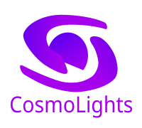

<p align="center">
  
</p>

<h1 align="center">CosmoLights</h1>

<p align="center">
  <strong>Controlador Ambilight de Ultra Baja Latencia y Efectos RGB en Tiempo Real</strong><br>
  Software de código abierto y alto rendimiento para tiras LED basadas en el controlador USB <strong>QinHeng Electronics</strong> (<code>VID: 0x1A86</code>, <code>PID: 0xFE07</code>).
</p>

<p align="center">
  
  
  
  
  
</p>

---

## Acerca de CosmoLights

CosmoLights nace como una alternativa nativa, segura, moderna y de alto rendimiento al software propietario `DX Light.exe`. Permite sincronizar la iluminación ambiental del monitor con latencia imperceptible (< 16 ms), eliminando procesos invasivos y ofreciendo personalización total.

Diseñado específicamente para configuraciones físicas modulares de 3 tiras LED (17 LEDs Izquierda + 29 LEDs Superior + 17 LEDs Derecha = 63 LEDs físicos mapeados en 34 zonas lógicas).

---

## Caracteristicas Principales

### 1. Motor Ambilight Inteligente
- **Captura GPU Directa (DirectX / WinRT Desktop Duplication):** Duplica fotogramas directamente de la VRAM a 30-60 FPS mediante `dxcam` sin consumir CPU en el renderizado ni mostrar bordes amarillos.
- **Compensacion de Barras Negras (Adaptive Letterbox):**
  - Deteccion automatica en tiempo real de formatos cinematograficos (21:9 UltraWide, 16:9 y 4:3 Retro).
  - Escaneo adaptativo de columnas de prueba (< 0.02 ms de computo) que ajusta el muestreo para evitar que la tira superior quede apagada en peliculas widescreen.
  - Transicion suave por interpolacion (LERP) entre relaciones de aspecto sin parpadeos.
- **Muestreo Perimetral Vectorizado (NumPy Strided Slicing):** Extraccion de los 3 bordes en < 0.5 ms de CPU.
- **Filtros de Color:**
  - Realce de saturacion ajustable (Saturation Boost).
  - Suavizado temporal exponencial (EMA) para transiciones fluidas de cine o respuesta instantanea en videojuegos.
  - Umbral de corte de negros (Black Cutoff) para apagar los LEDs por completo en escenas oscuras.

### 2. Soporte Robusto Multimonitor
- **Enumeracion hibrida Win32 + DXGI:** Deteccion confiable de todas las pantallas conectadas (`\\.\DISPLAY1`, `\\.\DISPLAY2`, etc.) mediante las APIs del sistema operativo.
- **Selector y Refresco en Vivo:** Boton para re-escanear pantallas al instante y cambiar de monitor de captura sin reiniciar la aplicacion.

### 3. Efectos Procedurales y Visualizadores de Audio
- **12 Efectos de Iluminacion Integrados:**
  - Rainbow Flow, Dynamic Wave, Breath Pulse, Color Comet, Aurora Borealis, Strobe Party, Fireplace Embers, Cyberpunk Glitch, Lava Lamp, Matrix Rain.
- **Visualizador de Audio Reactivo (WASAPI Loopback):**
  - Captura el audio del sistema sin cables virtuales adicionales.
  - **Fisica de audio mejorada:** Respuesta asimetrica de ataque/decaimiento (Attack/Decay), retencion de picos (Peak Hold) y amortiguacion elastica LERP.
  - Modos dedicados: Espectro Convergente (ondas bilaterales que colisionan en la parte superior), Pulso de Graves y Ecualizador de 3 Bandas (Bajos, Medios, Agudos).

### 4. Interfaz Moderna y Control Total
- **UI Webview2 en React 19 + Tailwind CSS:** Interfaz oscura y elegante en tonos purpura con animaciones fluidas y bajo consumo de recursos.
- **Rueda de Color HSV (Canvas):** Selector cromatico continuo y paleta de accesos rapidos para modo Color Fijo.
- **Monitor Virtual:** Vista previa en tiempo real de los 34 nodos LED sincronizados con la iluminacion fisica.
- **Persistencia Local Automatica:** Guarda monitor seleccionado, orientacion, brillo, velocidades, colores y sensibilidad en `%APPDATA%/CosmoLights/config.json`.
- **Integracion con System Tray:** Minimiza a la bandeja del sistema con menu contextual rapido.

---

## Mapeo de Hardware

El controlador QinHeng CH341 (`1A86:FE07`) se comunica por interrupciones USB (`Endpoint 0x01 OUT`, paquetes de 64 bytes). La distribucion modular se traduce de la siguiente manera:

```
                  [ Tira Superior: 29 LEDs (16 Zonas: 10 a 25) ]
       +--------------------------------------------------------------+
       |                                                              |
[ Tira |                                                              | [ Tira
Izq:   |                       MONITOR                                |  Der:
17     |                                                              |  17
LEDs   |                                                              |  LEDs
(9     |                                                              |  (9
Zonas: |                                                              |  Zonas:
1 a 9) |                                                              |  26 a 34)
       +--------------------------------------------------------------+
    Conexion USB / Inicio                                     Descenso
```

---

## Estructura del Proyecto

```
CosmoLights/
|-- main.py                       # Punto de entrada de la aplicacion y bandeja del sistema
|-- build.ps1                     # Script integral de compilacion (Vite + PyInstaller + Inno Setup)
|-- CosmoLights.spec              # Especificacion optimizada de PyInstaller
|-- requirements.txt              # Dependencias de Python
|-- package.json                  # Dependencias frontend (React, Vite, Lucide)
|-- vite.config.js                # Configuracion de empaquetado single-file de Vite
|-- run_cosmolights.bat           # Lanzador rapido para desarrollo
|-- packaging/
|   |-- installer.iss             # Script de Inno Setup 6 para el instalador
|   `-- version_info.txt          # Metadatos de version para Windows
|-- src/
|   |-- capture/
|   |   |-- base.py               # Clase base abstracta de captura
|   |   `-- windows_dxgi.py       # Captura de pantalla WinRT/DXGI y enumeracion Win32
|   |-- driver/
|   |   `-- led_driver.py         # Driver USB nativo (PyUSB / libusb) para 1A86:FE07
|   |-- engine/
|   |   |-- ambilight.py          # Motor de extraccion, letterbox dinamico y EMA
|   |   |-- audio_capture.py      # Captura WASAPI loopback y analisis FFT
|   |   |-- config_manager.py     # Gestor de persistencia en %APPDATA%/CosmoLights
|   |   `-- effects.py            # Motor de efectos procedurales y fisica de audio
|   `-- ui/
|       |-- api.py                # Bridge IPC entre Python y WebView2
|       |-- tray.py               # Menu de bandeja del sistema (pystray)
|       |-- assets/               # Logotipos e iconos vectoriales
|       |-- dist/                 # Bundle HTML/JS compilado para produccion
|       `-- react_src/            # Codigo fuente de React 19 (App, componentes, CSS)
```

---

## Instalacion y Uso

### Opcion 1: Mediante el Instalador (Recomendado para Usuarios)
Descarga el ejecutable generado `CosmoLights-Setup-1.0.0.exe` desde la seccion de [Releases](https://github.com/NarcisoDMC/CosmoLights/releases), instalalo con el asistente guiado y ejecutalo directamente desde el menu de inicio o escritorio.

### Opcion 2: Ejecucion desde Codigo Fuente (Desarrollo)

1. **Clonar el repositorio:**
   ```bash
   git clone https://github.com/NarcisoDMC/CosmoLights.git
   cd CosmoLights
   ```

2. **Crear y activar el entorno virtual de Python:**
   ```powershell
   python -m venv .venv
   .\.venv\Scripts\Activate.ps1
   ```

3. **Instalar dependencias de Python:**
   ```bash
   pip install -r requirements.txt
   ```

4. **Instalar dependencias y compilar el frontend React:**
   ```bash
   npm install
   npm run build
   ```

5. **Iniciar la aplicacion:**
   ```bash
   python main.py
   ```
   *(o simplemente ejecuta `run_cosmolights.bat`)*

---

## Compilacion y Generacion del Instalador

Para compilar el proyecto como un ejecutable independiente y crear el instalador de Windows:

1. Asegurate de tener instalado [Inno Setup 6](https://jrsoftware.org/isdl.php).
2. Ejecuta el script automatizado de PowerShell:
   ```powershell
   powershell -ExecutionPolicy Bypass -File build.ps1
   ```
El instalador final se generara en la carpeta `installer/CosmoLights-Setup-1.0.0.exe`.

---

## Licencia

Este proyecto se distribuye bajo la licencia **MIT**. Consulta el archivo `LICENSE` para mas detalles.
